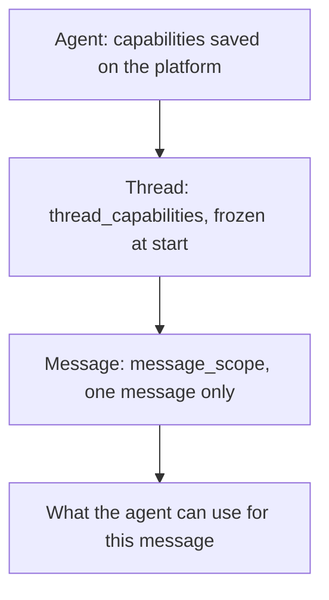

A **capability** is something an agent may use while it answers: search the
web, search your documents, call a connected tool, load a skill, generate an
image, or remember facts. Capabilities let you shape the agent's behavior from
your code, without creating a new agent each time.

You control them at two levels:

- `thread_capabilities` is set when the thread starts and frozen for its whole
  life.
- `message_scope` applies to one message only. It can turn a capability on or
  off, or narrow what it can reach.

This guide explains the model. To see it in action, start with the
[use cases](/guides/capabilities-use-cases). It works the same with the
[Python SDK](/sdk/reference#capabilities) and the
[HTTP API](/api-reference#capabilities).

{/* ILLUSTRATION: capabilities-hero */}

## The capabilities

| Capability | What the agent can do | Activation | Filter |
| ---------- | --------------------- | ---------- | ------ |
| `web` | Search the web | `always`, `on_request`, `never` | None |
| `indexed_documents` | Search and read your documents | `always`, `on_request`, `never` | `source_ids`, `document_ids` |
| `mcp` | Call tools of connected integrations (Linear, BigQuery, and more) | `always`, `on_request`, `never` | `connections` |
| `skills` | Load a skill | `always`, `never` | `include` |
| `image_generation` | Generate images | `always`, `on_request`, `never` | None |
| `video_generation` | Generate videos | `always`, `on_request`, `never` | None |
| `music_generation` | Generate music | `always`, `on_request`, `never` | None |
| `memory` | Read and write memory files in a namespace | `always`, `never` | `namespace` |

Skills and memory have no `on_request` mode. Neither has a per-message scope.
Set them on the agent or when the thread starts.

## Three layers

A message runs with the result of three layers, from the widest to the
narrowest.



| Layer | Where you set it | Lasts | Can do |
| ----- | ---------------- | ----- | ------ |
| Agent | [platform.cominty.ai](https://platform.cominty.ai), **Agents** page | Until you edit the agent | Define the defaults |
| Thread | `thread_capabilities` on `chat.start` | The whole thread | Override the agent, capability by capability |
| Message | `message_scope` on `chat.start` and `chat.send` | One message | Turn off, turn on, or narrow. Never widen |

{/* ILLUSTRATION: capabilities-three-layers */}

<Note>
  An agent with no capabilities saved behaves as if every capability were
  `always`, with no filter. Setting capabilities on the **Agents** page is how
  you make an agent more restrictive by default.
</Note>

## Activation

Every capability you send has an `activation`. It says when the capability runs.

| Activation | Meaning |
| ---------- | ------- |
| `always` | On for every message. A message can turn it off. |
| `on_request` | Installed but off. A message turns it on, for that message only. |
| `never` | Not installed. The agent cannot use it, and no message can change that. |

{/* ILLUSTRATION: capabilities-activation-modes */}

With `on_request`, the capability lasts one message. Send the scope again on
every message that needs it.

## Start a thread with capabilities

Pass a capability object for each one you want to set. Every capability is an
explicit object. There are no shortcuts such as `web=True` or
`web="on_request"`.

<Tabs>
  <Tab title="Python SDK">
    ```python
    from cominty_sdk import (
        AgentCapabilities,
        ImageGenerationCapability,
        McpCapability,
        WebCapability,
    )

    run = await client.chat.start(
        agent_id=AGENT_ID,
        message="Summarize the open tickets",
        thread_capabilities=AgentCapabilities(
            web=WebCapability(activation="never"),
            mcp=McpCapability(activation="always", connections=["linear"]),
            image_generation=ImageGenerationCapability(activation="on_request"),
        ),
    )
    print(await run.text())  # read the reply before you send the next message
    ```
  </Tab>
  <Tab title="HTTP">
    ```bash
    curl -X POST "https://ds.cominty.com/chat" \
      -H "x-cominty-token: $COMINTY_API_KEY" \
      -H "Content-Type: application/json" \
      -d '{
        "message": {"content": "Summarize the open tickets"},
        "options": {
          "agent_id": "'"$AGENT_ID"'",
          "user_id": "'"$COMINTY_USER_ID"'",
          "capabilities": {
            "web": {"activation": "never"},
            "mcp": {"activation": "always", "connections": ["linear"]},
            "image_generation": {"activation": "on_request"}
          }
        }
      }'
    ```
  </Tab>
</Tabs>

The follow-up `chat.send` does not accept `thread_capabilities`. To change the
thread's capabilities, start a new thread.

<Note>
  A thread handles one message at a time. Read the reply to the end (or cancel
  the message) before you send the next one, or `chat.send` returns a 400. See
  [One message at a time](/sdk/reference#one-message-at-a-time).
</Note>

## Change one message

`message_scope` takes a scope object for each capability you want to change on
this message. Each scope has a required `enabled`.

<Tabs>
  <Tab title="Python SDK">
    ```python
    from cominty_sdk import MessageScope, WebScope

    reply = await client.chat.send(
        run.thread.id,
        agent_id=AGENT_ID,
        message="Answer from what you already know.",
        message_scope=MessageScope(web=WebScope(enabled=False)),
    )
    ```
  </Tab>
  <Tab title="HTTP">
    ```bash
    curl -X POST "https://ds.cominty.com/chat/$THREAD_ID" \
      -H "x-cominty-token: $COMINTY_API_KEY" \
      -H "Content-Type: application/json" \
      -d '{
        "message": {
          "content": "Answer from what you already know.",
          "scope": {"web": {"enabled": false}}
        },
        "options": {"agent_id": "'"$AGENT_ID"'"}
      }'
    ```
  </Tab>
</Tabs>

What a scope does depends on how the thread installed the capability:

| Thread activation | `enabled=True` | `enabled=False` | No scope |
| ----------------- | -------------- | --------------- | -------- |
| `always` | On | Off for this message | On |
| `on_request` | On for this message | Rejected (422): it is already off | Off |
| `never`, or not set on the thread | Rejected (422) | Rejected (422) | Off |

The scope never carries over. The next message without a scope goes back to
the thread's activation.

## Filters

Some capabilities can be limited to a list of ids. The filter names are
`source_ids` and `document_ids` for documents, `connections` for MCP, and
`include` for skills.

- A filter defaults to `ALL`, the string `"*"`, which means no restriction.
  Passing `ALL` explicitly is the same as leaving the filter out.
- Otherwise a filter is a non-empty list.
- On a message, a filter can only **narrow** the thread's list. It must be a
  subset of it.
- `None`, an empty list, and `"*"` inside a list are invalid. The SDK raises
  `InvalidParams` before sending anything.
- A filter on `never` or on `enabled=False` is invalid too. Those states take
  no filter.

```python
from cominty_sdk import ALL, IndexedDocumentsCapability

IndexedDocumentsCapability(activation="always")                      # no filter
IndexedDocumentsCapability(activation="always", source_ids=ALL)      # same thing
IndexedDocumentsCapability(activation="always", source_ids=[2292])   # one source
```

For documents, sending one filter on a message replaces both. A scope with only
`document_ids` focuses the message on those documents and drops the thread's
`source_ids`.

## Find your ids

Filters take ids and names that you copy from the platform.

| Filter | Where to find it |
| ------ | ---------------- |
| `source_ids` | On [platform.cominty.ai/knowledge](https://platform.cominty.ai/knowledge), the **Documents** page. Copy the **ID** shown under the name of each source. |
| `document_ids` | The platform does not show them yet. Ask an agent that can search your documents: "Find the 2024 board deck and give me its document id." Then paste the id in your scope or capability. An id is the source id, a `#`, and the document's own identifier, for example `2292#8058`. That identifier is not always a number: it can also be a string of letters and digits, so copy the whole id as the agent gives it. |
| `connections` | The name of the integration on the **Integrations** page, for example `linear`. |
| `include` (skills) | The skill id on the **Skills** page. |

{/* ILLUSTRATION: capabilities-find-source-id */}

<Warning>
  The API does not check ids. An id that is mistyped or that you cannot read
  matches nothing, and the request still succeeds. If the agent finds nothing,
  check the id first.
</Warning>

## Set capabilities on an agent

An agent's own capabilities are set on
[platform.cominty.ai](https://platform.cominty.ai), on the **Agents** page. They
are the defaults for every thread started with that agent. `thread_capabilities`
and `message_scope` start from there.

## Override an agent for one thread

A capability you pass in `thread_capabilities` **replaces that capability
entirely**. The capabilities you do not pass keep the agent's value.

Take an agent configured with web search always on, and document search limited
to two sources:

| Capability | On the agent |
| ---------- | ------------ |
| `web` | `always` |
| `indexed_documents` | `always`, `source_ids=[2292, 2293]` |

You start a thread and redefine only `indexed_documents`, with a `document_ids`
filter and no `source_ids`:

```python
thread_capabilities=AgentCapabilities(
    indexed_documents=IndexedDocumentsCapability(
        activation="always",
        document_ids=["2292#8058"],
    ),
)
```

| Capability | On the thread | Why |
| ---------- | ------------- | --- |
| `web` | `always` | You did not pass it. The agent's value stays. |
| `indexed_documents` | `always`, `document_ids=[...]`, `source_ids=ALL` | You passed it. It is rewritten, so the agent's `source_ids` are gone. |

To keep the agent's sources, repeat them in the new object:

```python
IndexedDocumentsCapability(
    activation="always",
    source_ids=[2292, 2293],
    document_ids=["2292#8058"],
)
```

To switch web search off, say so. Leaving `web` out never turns it off:

```python
thread_capabilities=AgentCapabilities(web=WebCapability(activation="never"))
```

{/* ILLUSTRATION: capabilities-override-one-capability */}

<Warning>
  `thread_capabilities` can turn on a capability that the agent sets to
  `never`. Do not rely on `never` on the agent to keep a capability away from
  callers who can start a chat with it.
</Warning>

## Memory

Memory is a capability like the others. It decides which memory namespace the
thread reads and writes.

```python
from cominty_sdk import AgentCapabilities, MemoryCapability

thread_capabilities=AgentCapabilities(
    memory=MemoryCapability(activation="always", namespace="support-bot"),
)
```

- `activation="always"` needs a `namespace` of 1 to 128 characters.
- `activation="never"` runs the thread without memory, even if the agent has a
  namespace. It takes no namespace.
- Without a `memory` entry, the thread uses the agent's namespace. If the agent
  has none, the thread runs without memory.
- The namespace is frozen for the thread. A follow-up cannot change it.

{/* ILLUSTRATION: capabilities-memory-frozen */}

See [Memory namespaces](/guides/memory-namespaces) for the files themselves.

## Limits to know

- **The thread's capabilities are not returned.** No endpoint tells you what a
  thread was started with. Keep what you sent if you need to show it.
- **Editing an agent does not change existing threads.** A thread keeps the
  capabilities it started with. Start a new thread to pick up the change.
- **A follow-up cannot change the agent's capabilities.** Changing `agent_id` on
  `chat.send` does not change the thread's capabilities either.
- **A message can only narrow.** Widening a filter, or targeting a capability
  the thread does not have, returns a 422.

## Next steps

<CardGroup cols={2}>
  <Card title="Use cases" icon="lightbulb" href="/guides/capabilities-use-cases">
    Recipes from one message to a full thread policy.
  </Card>
  <Card title="Troubleshooting and migration" icon="wrench" href="/guides/capabilities-troubleshooting">
    Move from `disabled_tools`, and fix 422 errors.
  </Card>
</CardGroup>
