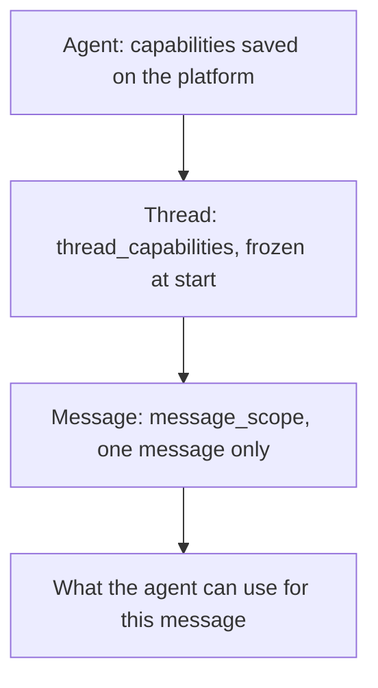

A **capability** is something an agent may use while it answers: search the
web, search your documents, call a connected tool, load a skill, generate an
image, or remember facts. Capabilities let you shape the agent's behavior from
your code, without creating a new agent each time.

You control them at three levels:

- The **agent** saves default capabilities on the platform.
- `thread_capabilities` sets what the thread has. It is frozen when the thread
  starts.
- `message_scope` focuses one message. It turns a capability on or off, or
  narrows what it can reach, for that message only.

Keep one rule in mind: **capabilities give the thread its tools, and a scope
focuses one message.** A scope never adds a tool that the thread does not have.

This guide explains the model. To see it in action, start with the
[use cases](/guides/capabilities-use-cases). It works the same with the
[Python SDK](/sdk/reference#capabilities) and the
[HTTP API](/api-reference#capabilities).

## The capabilities

| Capability | What the agent can do | Activation | Filter |
| ---------- | --------------------- | ---------- | ------ |
| `web` | Search the web | `always`, `on_request`, `never` | None |
| `indexed_documents` | Search and read your documents | `always`, `on_request`, `never` | `source_ids`, `document_ids` |
| `mcp` | Call tools of connected integrations (Linear, BigQuery, and more) | `always`, `on_request`, `never` | `connections` |
| `skills` | Load a skill | `always`, `never` | `include` |
| `image_generation` | Generate images | `always`, `on_request`, `never` | None |
| `video_generation` | Generate videos | `always`, `on_request`, `never` | None |
| `music_generation` | Generate music | `always`, `on_request`, `never` | None |
| `memory` | Read and write memory files in a namespace | `always`, `never` | `namespace` |

Skills and memory have no `on_request` mode. Neither has a per-message scope.
Set them on the agent or when the thread starts.

## Three layers

A message runs with the result of three layers, from the widest to the
narrowest.



| Layer | Where you set it | Lasts | Can do |
| ----- | ---------------- | ----- | ------ |
| Agent | [platform.cominty.ai](https://platform.cominty.ai), **Agents** page | Until you edit the agent | Define the defaults |
| Thread | `thread_capabilities` on `chat.start` | The whole thread | Override the agent, capability by capability |
| Message | `message_scope` on `chat.start` and `chat.send` | One message | Turn off, turn on, or narrow. Never widen |

<Note>
  An agent with no capabilities saved behaves as if every capability were
  `always`, with no filter. That is the case of the built-in Chat and Hive
  agents (see [Built-in agents](/guides/agents)). Setting capabilities on the
  **Agents** page is how you make an agent more restrictive by default.
</Note>

<Warning>
  The built-in Planner agent ignores capabilities and scopes, except memory. It
  has no tools to restrict. See [Planner](/guides/agents#planner).
</Warning>

### The agent is a saved default

An agent's capabilities are a preset. Each thread copies them when it starts.
You could pass the same `thread_capabilities` on every `chat.start` and get the
same threads. The agent saves you from sending them each time.

### Capabilities give tools, scopes focus

Capabilities, from the agent or from `thread_capabilities`, decide which tools
the thread has. A capability the thread has is installed: its tools and their
instructions are in the agent's system prompt, on every message. With `never`,
the capability is not installed at all.

A scope installs nothing and removes nothing. It switches an installed
capability on or off for one message, or narrows its filter. The agent still
sees the tool. If it calls a tool that is off for this message, the call returns
an error that says so.

| | Capabilities (agent or thread) | Message scope |
| - | ------------------------------ | ------------- |
| Answers | Which tools does this thread have? | What should this message focus on? |
| Effect | Installs a capability, or removes it with `never` | Switches an installed capability on or off, or narrows its filter |
| What the agent sees | The tools and their instructions | The same tools, plus a note before your message that says what is on for this message |
| Lasts | The whole thread | One message |

Use a scope to focus the agent on one task: only the web, only your documents,
one or a few sources, or a few documents.

## Activation

Every capability you send has an `activation`. It says when the capability runs.

| Activation | Meaning |
| ---------- | ------- |
| `always` | On for every message. A message can turn it off. |
| `on_request` | Installed but off. A message turns it on, for that message only. |
| `never` | Not installed. The agent cannot use it, and no message can change that. |

<Frame>
  
  
</Frame>

With `on_request`, the capability lasts one message. Send the scope again on
every message that needs it.

### Choose an activation

Pick the activation from how often the thread needs the capability:

- **On every message:** `always`. Set it on the agent, so every thread has it
  without asking. A message can still turn it off.
- **Only on the messages you choose:** `on_request`. The capability stays off
  until a scope turns it on, for one message.
- **Never:** `never`. The capability is not installed. Once a thread starts
  with `never`, no message can turn it on.

## Start a thread with capabilities

Pass a capability object for each one you want to set. Every capability is an
explicit object. There are no shortcuts such as `web=True` or
`web="on_request"`.

<Tabs>
  <Tab title="Python SDK">
    ```python
    from cominty_sdk import (
        AgentCapabilities,
        ImageGenerationCapability,
        McpCapability,
        WebCapability,
    )

    run = await client.chat.start(
        agent_id=AGENT_ID,
        message="Summarize the open tickets",
        thread_capabilities=AgentCapabilities(
            web=WebCapability(activation="never"),
            mcp=McpCapability(activation="always", connections=["linear"]),
            image_generation=ImageGenerationCapability(activation="on_request"),
        ),
    )
    print(await run.text())  # read the reply before you send the next message
    ```
  </Tab>
  <Tab title="HTTP">
    ```bash
    curl -X POST "https://ds.cominty.com/chat" \
      -H "x-cominty-token: $COMINTY_API_KEY" \
      -H "Content-Type: application/json" \
      -d '{
        "message": {"content": "Summarize the open tickets"},
        "options": {
          "agent_id": "'"$AGENT_ID"'",
          "user_id": "'"$COMINTY_USER_ID"'",
          "capabilities": {
            "web": {"activation": "never"},
            "mcp": {"activation": "always", "connections": ["linear"]},
            "image_generation": {"activation": "on_request"}
          }
        }
      }'
    ```
  </Tab>
</Tabs>

The follow-up `chat.send` does not accept `thread_capabilities`. To change the
thread's capabilities, start a new thread.

<Note>
  A thread handles one message at a time. Read the reply to the end (or cancel
  the message) before you send the next one, or `chat.send` returns a 400. See
  [One message at a time](/sdk/reference#one-message-at-a-time).
</Note>

## Change one message

`message_scope` takes a scope object for each capability you want to change on
this message. Each scope has a required `enabled`.

<Tabs>
  <Tab title="Python SDK">
    ```python
    from cominty_sdk import MessageScope, WebScope

    reply = await client.chat.send(
        run.thread.id,
        agent_id=AGENT_ID,
        message="Answer from what you already know.",
        message_scope=MessageScope(web=WebScope(enabled=False)),
    )
    ```
  </Tab>
  <Tab title="HTTP">
    ```bash
    curl -X POST "https://ds.cominty.com/chat/$THREAD_ID" \
      -H "x-cominty-token: $COMINTY_API_KEY" \
      -H "Content-Type: application/json" \
      -d '{
        "message": {
          "content": "Answer from what you already know.",
          "scope": {"web": {"enabled": false}}
        },
        "options": {"agent_id": "'"$AGENT_ID"'"}
      }'
    ```
  </Tab>
</Tabs>

What a scope does depends on how the thread installed the capability:

| Thread activation | `enabled=True` | `enabled=False` | No scope |
| ----------------- | -------------- | --------------- | -------- |
| `always` | On | Off for this message | On |
| `on_request` | On for this message | Rejected (422): it is already off | Off |
| `never`, or not set on the thread | Rejected (422) | Rejected (422) | Off |

The scope never carries over. The next message without a scope goes back to
the thread's activation.

A scope is enforced, but the agent picks its tools from your words. Say in the
message what you want it to use. See
[Help the agent follow a scope](#help-the-agent-follow-a-scope).

## Filters

Some capabilities can be limited to a list of ids. The filter names are
`source_ids` and `document_ids` for documents, `connections` for MCP, and
`include` for skills.

- A filter defaults to `ALL`, the string `"*"`, which means no restriction.
  Passing `ALL` explicitly is the same as leaving the filter out.
- Otherwise a filter is a non-empty list.
- On a message, a filter can only **narrow** the thread's list. It must be a
  subset of it.
- `None`, an empty list, and `"*"` inside a list are invalid. The SDK raises
  `InvalidParams` before sending anything.
- A filter on `never` or on `enabled=False` is invalid too. Those states take
  no filter.

```python
from cominty_sdk import ALL, IndexedDocumentsCapability

IndexedDocumentsCapability(activation="always")                      # no filter
IndexedDocumentsCapability(activation="always", source_ids=ALL)      # same thing
IndexedDocumentsCapability(activation="always", source_ids=[2292])   # one source
```

For documents, sending one filter on a message replaces both. A scope with only
`document_ids` focuses the message on those documents and drops the thread's
`source_ids`.

## Find your ids

Filters take ids and names that you copy from the platform.

| Filter | Where to find it |
| ------ | ---------------- |
| `source_ids` | On [platform.cominty.ai/knowledge](https://platform.cominty.ai/knowledge), the **Documents** page. Copy the **ID** shown under the name of each source. |
| `document_ids` | The platform does not show them yet. Ask an agent that can search your documents: "Find the 2024 board deck and give me its document id." Then paste the id in your scope or capability. An id is the source id, a `#`, and the document's own identifier, for example `2292#8058`. That identifier is not always a number: it can also be a string of letters and digits, so copy the whole id as the agent gives it. |
| `connections` | The name of the integration on the **Integrations** page, for example `linear`. |
| `include` (skills) | The skill id on the **Skills** page. |

<Frame caption="The Documents page of the platform. Copy the ID shown under a source name.">
  
  
</Frame>

<Warning>
  The API does not check ids. An id that is mistyped or that you cannot read
  matches nothing, and the request still succeeds. If the agent finds nothing,
  check the id first.
</Warning>

## Help the agent follow a scope

A scope is enforced: a tool that is off cannot run. But the agent chooses which
tool to try from your message. A message that names what to use gets the right
answer on the first try.

### What the agent sees

Before your message, Cominty adds a short note for the agent. It lists what is
on and off for this message, and the sources or documents the scope keeps. The
agent reads it, but it sometimes follows your words over the note. Two things
can go wrong:

- **It skips a capability you turned on.** A capability that is on is allowed,
  not required. If the question does not call for a search, the agent can
  answer from what it already knows.
- **It tries a capability you turned off.** You turn the web off and keep your
  documents on, then ask "How does my startup scale?". The agent tries the web,
  the call is refused, and it answers that it cannot find the information. It
  never searched your documents.

### Say it in the message

Name the capability, and the source if there is one, in the message itself.
Ask "In my documents, how does my startup scale?" instead of "How does my
startup scale?". With the same scope, the agent goes to your documents.

### Add a focus tag

For the strongest signal, add the tag that the platform's chat writes when you
mention something in a message (`@` for the web, your documents, or an
integration, `#` for a folder or a file). The agent's instructions describe
these tags.

| To focus on | Tag to put in the message |
| ----------- | ------------------------- |
| The web | `<use tools="*_web"/>` |
| Your documents | `<use tools="company_doc_*"/>` |
| An integration | `<use agent="linear"/>`, with the name from the **Integrations** page |

For one source or one document, the tag also carries the id and a name:

```xml
<scope type="document"><include_sources><source id="2292" name="Board decks"/></include_sources></scope>

<scope type="document"><include_documents><document id="2292#8058" name="2024 board deck"/></include_documents></scope>
```

A tag is only text for the agent. It does not restrict anything: the scope
does. Send both, so the agent knows where to look and cannot look elsewhere.

<Tabs>
  <Tab title="Python SDK">
    ```python
    from cominty_sdk import IndexedDocumentsScope, MessageScope, WebScope

    focus = (
        '<scope type="document"><include_sources>'
        '<source id="2292" name="Board decks"/>'
        "</include_sources></scope>"
    )

    run = await client.chat.start(
        agent_id=AGENT_ID,
        message=f"{focus} In these documents, how does my startup scale?",
        message_scope=MessageScope(
            web=WebScope(enabled=False),
            indexed_documents=IndexedDocumentsScope(
                enabled=True,
                source_ids=[2292],
            ),
        ),
    )
    print(await run.text())
    ```
  </Tab>
  <Tab title="HTTP">
    ```bash
    curl -X POST "https://ds.cominty.com/chat" \
      -H "x-cominty-token: $COMINTY_API_KEY" \
      -H "Content-Type: application/json" \
      -d '{
        "message": {
          "content": "<scope type=\"document\"><include_sources><source id=\"2292\" name=\"Board decks\"/></include_sources></scope> In these documents, how does my startup scale?",
          "scope": {
            "web": {"enabled": false},
            "indexed_documents": {"enabled": true, "source_ids": [2292]}
          }
        },
        "options": {
          "agent_id": "'"$AGENT_ID"'",
          "user_id": "'"$COMINTY_USER_ID"'"
        }
      }'
    ```
  </Tab>
</Tabs>

## Set capabilities on an agent

An agent's own capabilities are set on
[platform.cominty.ai](https://platform.cominty.ai), on the **Agents** page. They
are the defaults for every thread started with that agent. `thread_capabilities`
and `message_scope` start from there.

## Override an agent for one thread

`thread_capabilities` follows two rules:

1. **The set of capabilities is merged.** A capability you pass is added to the
   agent's set, or replaces the agent's version. A capability you do not pass
   keeps the agent's value.
2. **Each capability you pass is replaced entirely.** Its filters do not merge
   with the agent's. A filter you leave out goes back to `ALL`.

The examples below start from this agent:

| Capability | On the agent |
| ---------- | ------------ |
| `web` | `always` |
| `indexed_documents` | `always`, `source_ids=[2292]` |
| `image_generation` | `always` |
| `skills` | Not set |

### Add a capability

```python
thread_capabilities=AgentCapabilities(
    skills=SkillsCapability(activation="always"),
)
```

The thread has web search, document search on source `2292`, image
generation, and skills. You added skills. The rest comes from the agent.

### Remove a capability

```python
thread_capabilities=AgentCapabilities(web=WebCapability(activation="never"))
```

The thread has no web search, on any message, and no scope can bring it back.
Documents and image generation keep the agent's values. Leaving `web` out never
turns it off: you have to send `never`.

### Redefine a capability

```python
thread_capabilities=AgentCapabilities(
    indexed_documents=IndexedDocumentsCapability(activation="on_request"),
)
```

| Capability | On the thread | Why |
| ---------- | ------------- | --- |
| `web` | `always` | You did not pass it. The agent's value stays. |
| `indexed_documents` | `on_request`, `source_ids=ALL`, `document_ids=ALL` | You passed it. It is rewritten, so the agent's source `2292` is gone. |
| `image_generation` | `always` | You did not pass it. The agent's value stays. |

You only meant to change the activation, but the thread can now search every
source. To keep the agent's source, repeat it in the new object:

```python
IndexedDocumentsCapability(activation="on_request", source_ids=[2292])
```

This is what lets you remove a source. If filters merged with the agent's, a
thread could add sources but never take one away. Instead, you send the list you
want, and the thread uses that list.

<Warning>
  `thread_capabilities` can turn on a capability that the agent sets to
  `never`. Do not rely on `never` on the agent to keep a capability away from
  callers who can start a chat with it.
</Warning>

## Memory

Memory is a capability like the others. It decides which memory namespace the
thread reads and writes.

```python
from cominty_sdk import AgentCapabilities, MemoryCapability

thread_capabilities=AgentCapabilities(
    memory=MemoryCapability(activation="always", namespace="support-bot"),
)
```

- `activation="always"` needs a `namespace` of 1 to 128 characters.
- `activation="never"` runs the thread without memory, even if the agent has a
  namespace. It takes no namespace.
- Without a `memory` entry, the thread uses the agent's namespace. If the agent
  has none, the thread runs without memory.
- The namespace is frozen for the thread. A follow-up cannot change it.

See [Memory namespaces](/guides/memory-namespaces) for the files themselves.

## Limits to know

- **The thread's capabilities are not returned.** No endpoint tells you what a
  thread was started with. Keep what you sent if you need to show it.
- **Editing an agent does not change existing threads.** A thread keeps the
  capabilities it started with. Start a new thread to pick up the change.
- **A follow-up cannot change the agent's capabilities.** Changing `agent_id` on
  `chat.send` does not change the thread's capabilities either.
- **A message can only narrow.** Widening a filter, or targeting a capability
  the thread does not have, returns a 422.

## Next steps

<CardGroup cols={2}>
  <Card title="Use cases" icon="lightbulb" href="/guides/capabilities-use-cases">
    Recipes from one message to a full thread policy.
  </Card>
  <Card title="Troubleshooting and migration" icon="wrench" href="/guides/capabilities-troubleshooting">
    Move from `disabled_tools`, and fix 422 errors.
  </Card>
</CardGroup>
