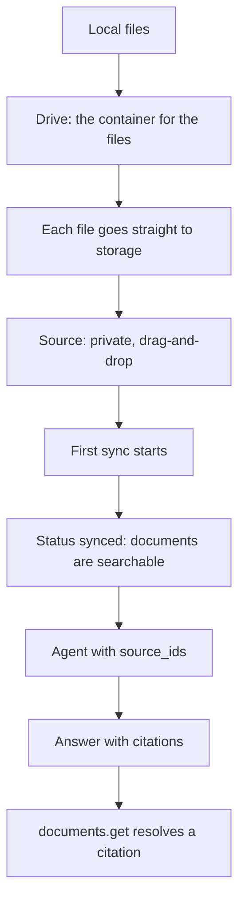

A source is a set of files that Cominty indexes, so an agent can search them and
cite them. With an API key, you create a source from files on your machine. The
SDK does it in one call. Read
[Custom agents](/guides/custom-agents#what-an-api-key-can-do) first for what an
API key can and cannot see.

Each snippet has a tab for the [Python SDK](/sdk/overview) and for HTTP.

<Info>
  Only **drag-and-drop** sources can be created with a key. Google Drive and
  SharePoint sources need the console's OAuth flow. They can show up in
  `sources.list()` as organization sources, but you cannot create them here.
</Info>

## How it works



`sources.create` runs the first four steps and returns while the source is
`pending` or `syncing`. Wait until it is `synced` before you search it.

## Create a source

<Warning>
  Your files are not available to the agent as soon as the source is created and
  the upload ends. The platform must first index every file. Until the source
  is `synced`, the agent finds nothing, or only some of the files. Wait for
  `synced` before you start a chat. With the SDK, use `sources.wait_synced`. Over
  HTTP, poll `GET /dc/sources` until `status` is `synced`.
</Warning>

<Tabs>
  <Tab title="Python SDK">
    ```python
    from pathlib import Path

    source = await client.sources.create(Path("docs"), name="Product docs")
    source = await client.sources.wait_synced(source.pid, timeout=420, interval=3)
    print(source.model_dump_json(indent=2))
    ```
  </Tab>
  <Tab title="HTTP">
    Creating a source is a 5-step flow. Steps 2 to 4 are the same
    [presigned upload](/api-reference#files-and-exports) as for chat files.

    ```bash
    BASE_URL=https://ds.cominty.com
    AUTH="x-cominty-token: $COMINTY_API_KEY"

    # 1. Create a drive
    DRIVE_ID=$(curl -s -X POST "$BASE_URL/drives" -H "$AUTH" | jq -r .id)

    # 2. Ask for an upload permission
    PERMIT=$(curl -s -G "$BASE_URL/drives/$DRIVE_ID/upload" -H "$AUTH" \
      --data-urlencode filename=facts.txt \
      --data-urlencode mimetype=text/plain)

    # 3. Upload the file to the storage host. Do not send the API key there.
    URL=$(echo "$PERMIT" | jq -r .url)
    FORM=()
    while IFS= read -r field; do FORM+=(-F "$field"); done < <(
      echo "$PERMIT" | jq -r '.fields | to_entries[] | "\(.key)=\(.value)"'
    )
    ETAG=$(curl -s -D - -o /dev/null "${FORM[@]}" \
      -F "file=@facts.txt;type=text/plain" "$URL" \
      | tr -d '\r' | awk -F': ' 'tolower($1)=="etag"{print $2}')

    # 4. Confirm the upload
    KEY=$(echo "$PERMIT" | jq -r .fields.key)
    curl -s -X POST "$BASE_URL/drives/upload" -H "$AUTH" \
      -H "Content-Type: application/json" \
      -d "{\"etag\": $ETAG, \"key\": \"$KEY\"}"

    # 5. Create the source over the drive. The first sync starts.
    curl -s -X POST "$BASE_URL/dc/sources" -H "$AUTH" \
      -H "Content-Type: application/json" \
      -d "{\"name\": \"Product docs\", \"store\": \"draganddrop\",
           \"scope\": \"private\", \"config\": {\"drive_id\": \"$DRIVE_ID\"}}"
    ```

    The file field must come last in step 3. Send the `ETag` with its quotes
    in step 4. Poll `GET /dc/sources` until the source has `status` `synced`.
  </Tab>
</Tabs>

```json
{
  "id": 2698,
  "pid": "oGCnsJeH-fyO",
  "created_at": "2026-11-04T11:22:21.956451Z",
  "name": "Product docs",
  "scope": "private",
  "created_by": "user_31HPTBuBvX20xlQNAbvxjOxPbKB",
  "store": "draganddrop",
  "status": "synced",
  "size": 111,
  "embedded_size": 60,
  "config": {"meta": {"status": "ok", "errors": null}, "values": {"drive_id": "NgvpdTDFHCeW"}},
  "documents_synced": 2,
  "documents_failed": 0,
  "oversized_documents": 0,
  "documents_embedded": 1,
  "last_synced_at": "2026-11-04T11:22:27.200315Z",
  "archived_at": null
}
```

`files` can be one file `Path`, a folder `Path` (its top-level files only, no
recursion, hidden files skipped), or an iterable of file `Path`s. The SDK refuses
these before any upload with `InvalidParams`:

- a plain `str`: wrap a path in `Path(...)`;
- an empty list, or a file that does not exist;
- two files with the same name;
- more than 50 files.

`name` is optional. Without it, the server generates one.

### Two ids

A source has two ids. Do not mix them up.

| Field | Type | Where it goes |
| ----- | ---- | ------------- |
| `source.pid` | `str` | Every `client.sources` method, and every HTTP path |
| `source.id` | `int` | `IndexedDocumentsCapability(source_ids=[...])` and `IndexedDocumentsScope(source_ids=[...])` |

### Wait for the sync

`wait_synced(pid, *, timeout=600.0, interval=5.0)` polls the source every
`interval` seconds.

| Status it sees | What it does |
| -------------- | ------------ |
| `synced` | Returns the `SourceOut` |
| `pending`, `syncing`, `out_of_sync`, `cancelling`, `pausing` | Keeps polling |
| Anything else (`error`, `paused`, `archived`, `daily_quota_reached`, `invalid_configuration`, ...) | Raises `SourceSyncFailed`. The source as last read is `exc.source`. |
| Still in progress after `timeout` | Raises `asyncio.TimeoutError` |

```python
from cominty_sdk import SourceSyncFailed

try:
    await client.sources.wait_synced(source.pid, timeout=60, interval=2)
except SourceSyncFailed as exc:
    print(exc)                      # source 'oGCnsJeH-fyO' stopped in status 'paused' instead of reaching 'synced'
    print(exc.source.status.value)  # paused
```

## Give the source to an agent

Put the source's number `id` in an `IndexedDocumentsCapability`.

<Tabs>
  <Tab title="Python SDK">
    ```python
    from cominty_sdk import (
        AgentCapabilities,
        IndexedDocumentsCapability,
        WebCapability,
    )

    agent = await client.agents.create(
        name="Docs assistant",
        instructions=(
            "Answer only from the company documents, always search them first. "
            "Cite the documents you used."
        ),
        capabilities=AgentCapabilities(
            indexed_documents=IndexedDocumentsCapability(
                activation="always", source_ids=[source.id]
            ),
            web=WebCapability(activation="never"),
        ),
    )
    ```
  </Tab>
  <Tab title="HTTP">
    ```bash
    curl -X POST "https://ds.cominty.com/agents" \
      -H "x-cominty-token: $COMINTY_API_KEY" \
      -H "Content-Type: application/json" \
      -d '{
        "name": "Docs assistant",
        "instructions": "Answer only from the company documents, always search them first. Cite the documents you used.",
        "capabilities": {
          "indexed_documents": {"activation": "always", "source_ids": [2698]},
          "web": {"activation": "never"}
        }
      }'
    ```
  </Tab>
</Tabs>

You can also pass the source in `thread_capabilities` on `chat.start`, or narrow
it for one message with `IndexedDocumentsScope`. See
[Capabilities](/guides/capabilities#find-your-ids).

### Chat with the key owner's user id

A source created with a key is **private to the key owner**. A chat that searches
it must run with the owner's id as `user_id`. The owner is `agent.owner` on any
agent the key created.

<Tabs>
  <Tab title="Python SDK">
    ```python
    from cominty_sdk import AsyncCominty

    async with AsyncCominty(user_id=agent.owner) as owner_client:
        run = await owner_client.chat.start(
            agent_id=agent.id, message="What is the code word?"
        )
        message = await run.result()
    print(message.content)
    # The code word is **tangerine-4f2a**. <cite document_id="2698#10778" pages="1" name="facts.txt"/>
    ```
  </Tab>
  <Tab title="HTTP">
    Send the owner's id in `options.user_id` on `POST /chat`.
  </Tab>
</Tabs>

With any other `user_id`, the agent's document tool reports `You have no
authorized document sources.` The agent then says it found nothing. The
`COMINTY_USER_ID` of your client may not be the key owner, so read `agent.owner`.

## Read a citation

An answer cites its documents inline, as
`<cite document_id="2698#10778" pages="1" name="facts.txt"/>`. The id is the
source id, a `#`, and the document's own identifier. It is not always a number.
Resolve it to its source and file:

<Tabs>
  <Tab title="Python SDK">
    ```python
    import re

    cites = re.findall(r'<cite document_id="([^"]+)"', message.content)
    document = await client.documents.get(cites[0])
    print(document.model_dump_json(indent=2))
    ```
  </Tab>
  <Tab title="HTTP">
    The id contains a `#`, so URL-encode it.

    ```bash
    curl -G "https://ds.cominty.com/documents" \
      -H "x-cominty-token: $COMINTY_API_KEY" \
      --data-urlencode "id=2698#10778"
    ```
  </Tab>
</Tabs>

```json
{
  "document_id": "2698#10778",
  "source_id": 2698,
  "source_pid": "oGCnsJeH-fyO",
  "source_type": "draganddrop",
  "document_name": "facts.txt",
  "document_uri": "https://app.cominty.com/cominty_drive/files/ZsripjwG2ohN",
  "document_extension": "txt",
  "document_mime_type": "text/plain"
}
```

- An unknown id raises `NotFoundError` (404). There is no call that lists
  documents. An empty id raises `ValueError` before any request.
- `document_uri` can be `None`. For a drag-and-drop source, it ends with the id
  of the file, the one `sources.download_file` takes.

To read the original file, list the source's files and download one:

<Tabs>
  <Tab title="Python SDK">
    ```python
    for file in await client.sources.list_files(source.pid):
        print(file.id, file.name, file.size, file.mimetype)

    content = await client.sources.download_file(file.id)   # bytes
    ```
  </Tab>
  <Tab title="HTTP">
    ```bash
    curl "https://ds.cominty.com/files/$FILE_ID" \
      -H "x-cominty-token: $COMINTY_API_KEY"
    ```

    The answer is a JSON string: a download URL, valid for 5 minutes. Fetch it
    without the API key.
  </Tab>
</Tabs>

`download_file` fetches the presigned URL for you, without sending the key. It
holds the whole file in memory.

## Keep a source up to date

<Note>
  New files follow the same rule. After `add_files` or `remove_file`, the source
  is indexed again, and the change reaches the agent only once the source is
  `synced` again.
</Note>

<Tabs>
  <Tab title="Python SDK">
    ```python
    added = await client.sources.add_files(source.pid, [Path("extra.csv")])
    source = await client.sources.wait_synced(source.pid)
    await client.sources.remove_file(source.pid, added[0].id)
    source = await client.sources.update(source.pid, name="Product docs (2026)")

    source = await client.sources.sync(source.pid)     # force a sync now
    source = await client.sources.pause(source.pid)    # cancels a running sync
    source = await client.sources.start(source.pid)    # only from paused
    source = await client.sources.archive(source.pid)  # terminal
    ```
  </Tab>
  <Tab title="HTTP">
    ```bash
    curl -X PUT "https://ds.cominty.com/dc/sources/$PID/status?operation=sync" \
      -H "x-cominty-token: $COMINTY_API_KEY"
    ```

    `operation` is `start`, `pause`, `sync`, or `archive`.
  </Tab>
</Tabs>

- `add_files` uploads into the source's drive, then requests a sync if the
  source's status accepts one. If a sync is already running, the new files are
  left for it or for the daily sync. The limit of 50 files counts the files
  already in the source.
- `remove_file` deletes the file, then requests a sync under the same rule. An
  empty `file_id` raises `ValueError`.
- `update` only changes the name. The drive of a drag-and-drop source cannot
  change.
- `list()` returns the key owner's sources and the organization's sources,
  archived ones included. `get(pid)` reads the list and picks, because a key has
  no single-source read. An unknown `pid` raises `NotFoundError`.

Each operation is valid from some statuses only. Any other combination is an
`APIError` with status 400 and `detail` `Operation is not valid`.

| Operation | Valid from |
| --------- | ---------- |
| `start` | `paused` |
| `pause` | A running sync, which it cancels |
| `sync` | `synced`, `error`, `out_of_sync`, `daily_quota_reached` |
| `archive` | Any status but `archived` |

<Warning>
  `archive` removes the indexed documents and the files. The source stays in the
  list with `status` `archived`. There is no delete, and no way back.
</Warning>

## Limits

- A source holds at most **50 files**. The SDK checks it before it uploads.
- A user has at most **100 drives**. Each `sources.create` makes one, and a drive
  cannot be deleted. Reuse a source and call `add_files` instead of creating a
  new one for every batch.
- A presigned download URL is valid for 5 minutes.
- Uploads go straight to storage. The API key never reaches the storage host,
  and presigned signatures never appear in error messages.

### Supported file types

The indexing pipeline reads more than 130 file formats. These are the most
common ones.

| Category | Common formats | Also supported |
| -------- | -------------- | -------------- |
| Documents | `pdf`, `docx`, `doc`, `pptx`, `ppt`, `rtf`, `txt`, `epub` | `docm`, `dot`, `dotm`, `pptm`, `pot`, `potm`, `potx`, `key`, `pages`, `hwp`, `wpd`, `wps`, `xml`, `vsd`, `vsdx`, and other office and legacy formats |
| Images | `jpg`, `jpeg`, `png`, `gif`, `bmp`, `tiff`, `webp`, `heic`, `heif` | `svg`, `htm`, `html` |
| Spreadsheets | `xlsx`, `xls`, `csv`, `tsv`, `numbers`, `ods` | `xlsm`, `xlsb`, `xlw`, `dif`, `slk`, `dbf`, `fods`, and other legacy formats |
| Audio | `mp3`, `wav`, `m4a`, `aac`, `ogg`, `oga`, `opus`, `flac`, `wma`, `aiff`, `amr` | Any other common audio format |
| Video | `mp4`, `mov`, `avi`, `mkv`, `webm`, `m4v`, `wmv`, `flv`, `mpeg`, `mpg`, `3gp`, `ts` | Any other common video format |
| Text | Plain text and text-like files: `text/*` types, `application/json`, and similar | - |

Audio and video files are **transcribed** by the indexing pipeline. Almost every
common audio and video format works. The agent searches
and reads the transcript. For a video, it does not see the images, only what is
said.

### What the agent can do with an indexed file

Indexing lets the agent **find** a file and **read its content**. Two limits
apply today:

- **Spreadsheets are not part of the search.** An Excel file (or another
  spreadsheet) is registered in the source with a document id, but the lexical
  and semantic search never returns its content. The agent can still list the
  documents of a source, spreadsheets included, and open one by its document
  id. It then reads the content extracted from the spreadsheet, as long as it is
  not too large. For a large spreadsheet, or to work on its data, attach the
  file to the chat with [`chat.upload_file`](/sdk/reference#client-chat) instead.
- **The agent cannot download the raw file.** It reads the indexed content, but it
  cannot fetch the original file to transform it, for example to edit a
  document or to compute on a spreadsheet. To get the original, use
  `sources.download_file` from your own code.

## Next steps

<CardGroup cols={2}>
  <Card title="Custom agents" icon="bot" href="/guides/custom-agents">
    Create and manage the agent that searches the source.
  </Card>
  <Card title="Capabilities" icon="sliders-horizontal" href="/guides/capabilities">
    Narrow the sources and documents of a thread or a message.
  </Card>
</CardGroup>
