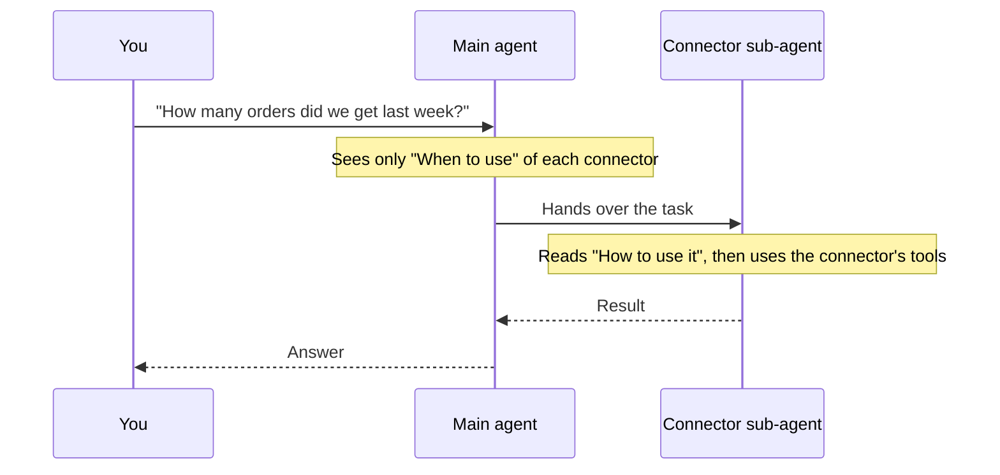

Each MCP connector you add to Cominty has an **Agent configuration** section
with two fields: **When to use** and **How to use it**. Filling them in is the
best way to make an agent use a connector well. It is also where you put the
details the agent cannot guess, such as a project ID.

## How a connector works behind the scenes

Every MCP connector runs as a **sub-agent**. The sub-agent has the connector's
tools and its own instructions. The main agent, the one you talk to, does the
work by handing tasks to the sub-agents.

The two fields map to the two sides of that hand-off:

| Field | Who reads it | What it is for |
| ----- | ------------ | -------------- |
| **When to use** | The main agent | Deciding whether to hand a task to this connector |
| **How to use it** | The connector's sub-agent | Doing the task: defaults, conventions, constraints |



This split has two consequences:

- The main agent **never sees** "How to use it". Do not put routing hints
  there. If the main agent does not hand the task over, the problem is in
  "When to use".
- The sub-agent follows "How to use it" every time. Anything that should be true
  on every task, such as a default project, belongs there. You do not need to
  repeat it in each message.

## Where to find the fields

<Steps>
  <Step title="Open the integration">
    On [platform.cominty.ai](https://platform.cominty.ai), open **Integrations**
    and choose the connector.
  </Step>
  <Step title="Scroll to Agent configuration">
    The section sits under **Configuration** (the credentials) and above
    **Permissions**.
  </Step>
  <Step title="Fill in the two fields, then save">
    Click **Save**, or **Connect** if you are setting the connector up for the
    first time.
  </Step>
</Steps>

<Frame caption="Agent configuration of the Google BigQuery integration">
  
</Frame>

**Permissions** controls which actions the integration can perform. It is
separate from the two instruction fields.

## Write "When to use"

Describe the situations and the types of tasks the connector covers, in a
sentence or two. The main agent reads it to choose between connectors, so be
specific about what is in scope.

```text
Use for BigQuery: run SQL queries, explore datasets, tables, and schemas.
```

Good "When to use" text:

- Names the tasks, not the product: "run SQL queries" tells more than "BigQuery".
- Says what belongs to another connector, if two overlap.
- Stays short. It is read on every message.

## Write "How to use it"

Give guidelines, constraints, or step-by-step directions. Think of what you
would tell a new colleague on their first day with this tool.

Good "How to use it" text:

- States the **fixed values** the connector needs: project ID, workspace,
  default dataset, team name.
- Explains how to map your words to those values: "When I talk about the
  project, use the ID `my-analytics-project`."
- Sets **rules**: "Never change data unless I ask", "Always confirm the record
  before you create it", "Search before you create."
- Lists a few **steps** for tasks you repeat.

## Example: BigQuery

BigQuery needs the **project ID** on almost every call. Write it once.

```text
The default project is my-analytics-project. This is the project ID, not the project name.
When the user talks about "the project", use my-analytics-project.
Start from the dataset sales unless the user names another one.
Use fully qualified table names, such as `my-analytics-project.sales.orders`.
Read the table schema with get_table_info before writing a query.
Prefer execute_sql_readonly. Use execute_sql only if the user clearly asks to change data.
Add a LIMIT when you explore a table.
```

With this in place, you can ask "Which products sold best last week?" and skip
the project ID. To find the ID, see the
[BigQuery guide](/mcp/integrations/bigquery#tell-the-agent-how-to-use-bigquery).

## Instructions and capabilities

Instructions are the same for every message. To change what an agent can reach
for one message or one thread, use [capabilities](/guides/capabilities). Turn off
the MCP capability, or keep only some connections, and the connector's sub-agent
is not available.

| You want to | Use |
| ----------- | --- |
| Give a connector default values or rules | **How to use it** |
| Help the main agent pick the connector | **When to use** |
| Block a connector for one message or one thread | `McpScope` or `McpCapability`, see [Capabilities](/guides/capabilities-use-cases#recipe-3-keep-some-connections-or-none) |
| Control which actions the integration can perform | **Permissions** on the integration |

## Troubleshooting

| Symptom | Likely cause |
| ------- | ------------ |
| The agent answers without using the connector | **When to use** is too vague, or does not cover the task. Name the tasks. |
| The agent uses the connector but asks for the project ID every time | The ID is missing from **How to use it**. Add it, with how to recognize when you mean it. |
| The agent uses the wrong default | Two defaults conflict in **How to use it**. Keep one, and say when to use another. |
| A change to the fields has no effect | The integration was not saved. Click **Save** again. |
