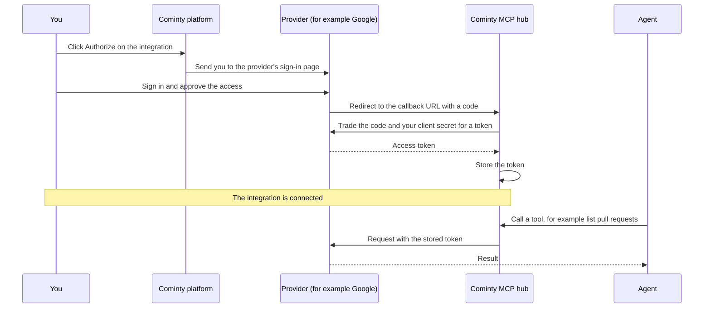

Most providers use OAuth. Some of them (GitHub, Google, Microsoft Entra, and
others) ask you to register an application before you can connect. During
registration they ask for a **redirect URI**, also called a **callback URL**.

Use this one:

```text
https://mcp.cominty.com/v2/oauth/callback
```

## What a callback URL is

When you connect an integration, you sign in on the provider's own website, not
on Cominty. The provider never shares your password with Cominty. Instead, once
you approve the access, it sends your browser back to a web address that you
registered in advance. That address is the callback URL.

The provider adds a short-lived **code** to the address when it redirects you.
Cominty receives that code at the callback URL and trades it for an access
token. The token is what lets agents call the provider's tools.

The provider only redirects to addresses it already knows. That is why it asks
you to register the callback URL first: it prevents anyone else from receiving
the code.

## When you need one

You need the callback URL when a provider asks you to register your own OAuth
app. You paste the URL into the app's form, and the provider gives you a client
ID and a client secret in return.

| Situation | What to do |
| --------- | ---------- |
| The provider asks you to create an app (Google Cloud, for example) | Register the app with the callback URL above, then add the client ID and secret in Cominty. |
| The integration is already set up for you on the platform | Nothing to register. Click **Authorize**. |

Each provider has its own steps. For Google BigQuery, see the
[BigQuery guide](/mcp/integrations/bigquery).

## How it fits in the flow



1. You click **Authorize**. Your browser goes to the provider.
2. You sign in with the provider and approve the access.
3. The provider redirects your browser to the callback URL, with a code.
4. The MCP hub trades the code, together with your client secret, for a token.
5. Cominty stores the token. From then on, agents call the provider's tools with
   it, and you never repeat steps 1 to 4 unless the token is revoked.

The callback URL only matters at step 3. If it does not match what you
registered, the provider stops the flow there.

## Rules

- Paste the URL exactly as shown. Providers compare it character by character.
- Keep `https` and do not add a trailing slash.
- Register it as a redirect URI, not as a webhook or homepage URL.
- Use the same URL for every integration.

## After registering

The provider gives you a **client ID** and a **client secret**. Add both to the
integration in Cominty. Treat the secret like a password. If it leaks, rotate
it at the provider.

## Troubleshooting

| Symptom | Likely cause |
| ------- | ------------ |
| `redirect_uri_mismatch` | The callback URL in the provider's app is not exactly `https://mcp.cominty.com/v2/oauth/callback`. Check the scheme, the path, and the trailing slash. |
| `invalid_client` | The client ID or the client secret in Cominty is wrong, or the secret was regenerated. Copy them again from the provider. |
| `access_denied` | You declined the access on the provider's page, or an organization admin has to approve the app first. |
| The connection worked, then stopped | The token was revoked, or the client secret was rotated at the provider. Authorize again. |

<Info>
  Does the provider restrict access by IP? Allowlist the MCP hub address listed
  on the [Static IP addresses](/guides/static-ip) page.
</Info>

<Warning>
  Registering the wrong callback URL is the most common cause of a
  `redirect_uri_mismatch` error. Check the URL first when authorization fails.
</Warning>
